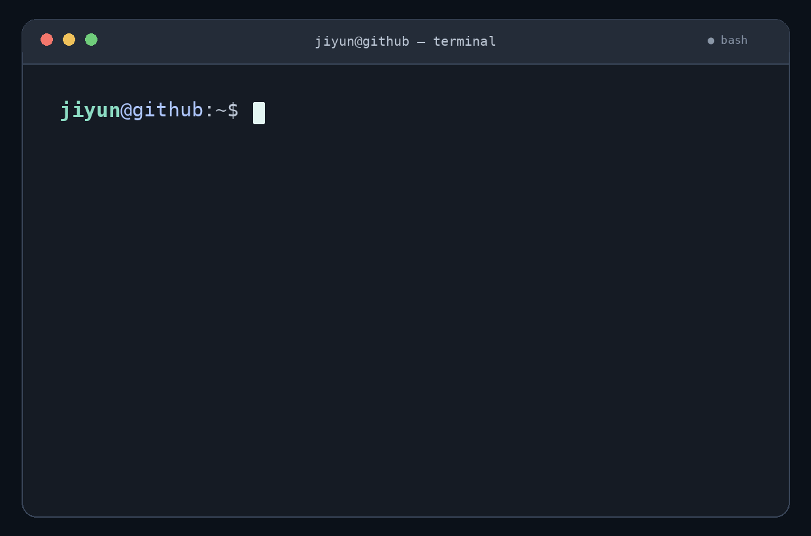

 

### `>_` About Me
---

- 🎓 Computer Science student at the **University of Seoul**
- 🛠️ Interested in **backend systems, infrastructure, and AI Agent**
- 🌱 Learning how to design, deploy, and operate services more effectively
 

### `>_` Tech Stack
---

**Language** 
  

**Backend**
  

**Database**

**Infra / DevOps**
  

